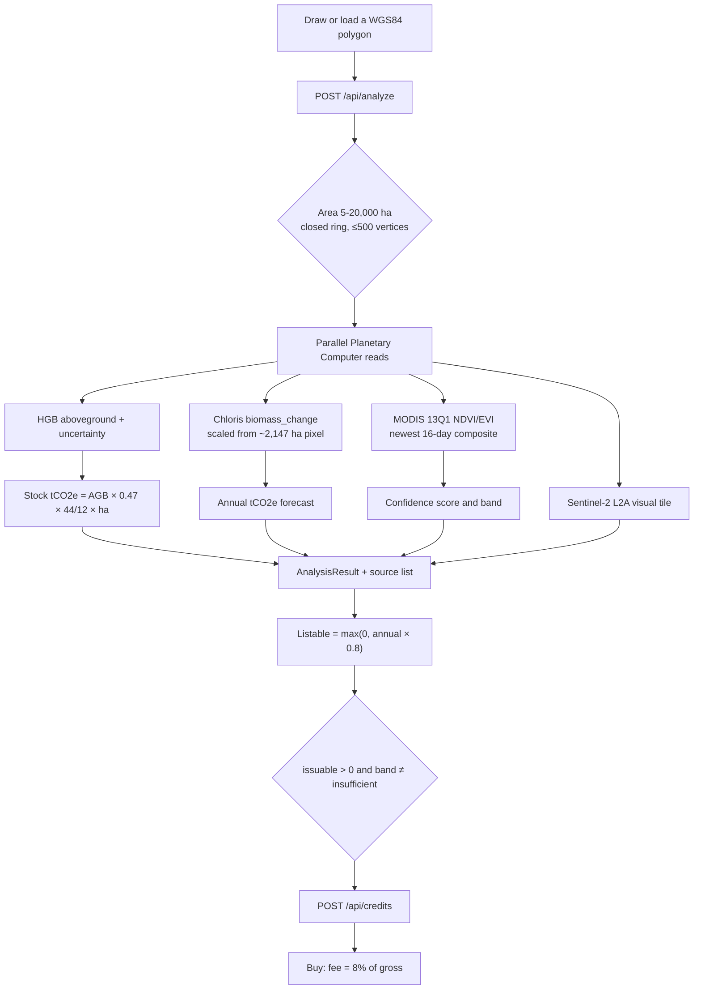

# CarbonSight

Real-time satellite intelligence for bankable carbon credits.

Pitch deck: [docs/CarbonSight.pptx](docs/CarbonSight.pptx)

[Most Technically Complex](https://github.com/DoggoOP/SatelliteCarbonCreditTrading) · Best Overall · Berkeley × Stanford Grok Bot Hackathon 2026

Draw a forest boundary. CarbonSight queries live public Earth-observation archives on [Microsoft Planetary Computer](https://planetarycomputer.microsoft.com/api/stac/v1/collections) and returns standing carbon, an annual removal forecast, and a confidence score. **Only the buffered annual removal can be listed.** Standing stock is inventory, not a credit.

Repo: [DoggoOP/SatelliteCarbonCreditTrading](https://github.com/DoggoOP/SatelliteCarbonCreditTrading)

## Inspiration

Carbon markets are a trust and measurement problem. Forestry and land-use credits are a large share of the voluntary market — Ecosystem Marketplace’s *State of the Voluntary Carbon Markets 2024* put 2022 forestry and land-use transactions at **$1.1 billion** on 113.0 Mt, and 2023 at **$351.3 million** on 36.2 Mt — while the World Bank’s *State and Trends of Carbon Pricing 2024* recorded **$104 billion** in carbon-pricing revenues across 75 instruments covering about 24 percent of global emissions. Buyers will come back only if the tonne on the screen is measured, buffered, and honest about what it is not.

That is the problem this team was built to work on:

- A **quant** lens treats issuance as pricing under uncertainty: a stand has a stock, a rate, and a residual risk, and only the buffered rate should clear.
- A **quant + remote sensing** lens insists the rate come from public sensors and published maps — not a hand-waved index — and that every layer keep a citation, a retrieval time, and a status.
- **Climate tech, mechanical engineering, geology, and remote sensing** know what field verification actually costs: **6–18 months** and **$20–100k**, after which a buyer still often gets a PDF. Public archives can screen a stand in minutes if the math stays conservative.
- **Aero/astro and remote sensing** bring orbital instruments and revisit cadence into the product: 16-day MODIS vegetation composites, a 10 m Sentinel-2 backdrop, and mapped biomass and change layers served through a single STAC catalog, with no API key and no mock file on the demo path.

CarbonSight is the tool that team wanted: draw a polygon, read the satellites, list only buffered removals, and show the gaps.

## What it does

A landowner, project developer, or credit buyer can:

1. **Draw** a forest boundary on a MapLibre map, paste GeoJSON, or open a preset (Humboldt redwoods, Central Amazon, Sierra Nevada). Area is computed on the sphere, not a flat map. The primary call to action on the landing page goes to `/analyze?preset=redwoods`.
2. **Read satellites.** `POST /api/analyze` runs four live Planetary Computer requests in parallel and returns standing stock, an annual removal forecast, a 0–100 confidence score with a high / medium / low / insufficient band, a source list, and warnings.
3. **List buffered removals.** The results panel leads with **listable tCO₂e per year** (`credits.annualIssuableTco2e`). Standing stock is a smaller stat. The disclaimer in `result.credits.disclaimer`, the warnings, and the source list (`name`, `status`, `note`) stay visible. The list button calls `onList` → `POST /api/credits` only when issuable volume is positive and confidence is not `insufficient`.
4. **Trade.** Buyers purchase a slice on `/market`. The ledger takes a fixed **8%** success fee (`PLATFORM_FEE_FRACTION = 0.08`). `/portfolio` totals listed, remaining, and purchased tonnes, plus gross and fees.

The product is a screening and trading surface, not a registry issuance. Every result carries this sentence:

> Illustrative removal estimate from public satellite data, after a 20% non-permanence buffer. Not a Verra, Gold Standard, or ACR issuance.

Access is designed as monthly subscriptions — **Scout $49**, **Project $149**, **Desk $299** — with the 8% fee applied only when a tonne actually trades. The fee already runs in the ledger today.

## How we built it (tech stack)

The shipping demo is the TypeScript app on `main`. It is a React / Vite frontend and a small Express API. All live Earth-observation reads go through Microsoft Planetary Computer’s STAC and Data APIs. There is no Python process, no FastAPI service, and no `data-engine/` directory on the demo path. No API key is required.

**Frontend** (`package.json`, `src/`, `vite.config.ts`)

- React 19, React Router 7, TypeScript, Vite 6 (dev server on port 5173; `/api` proxied to `http://localhost:8787`)
- Tailwind CSS 3, with named color tokens `canvas`, `paper`, `ink`, `muted`, `canopy`, `copper`, and `line`
- MapLibre GL 5 (`src/features/map/MapWorkbench.tsx`) — no Leaflet
- Recharts 2 (`src/features/results/ResultsPanel.tsx`) for the NDVI chart when `vegetation.timeseries` has two or more points; a short “one composite” line otherwise
- Routes in `src/App.tsx`, wrapped in `AppShell`: `/`, `/analyze`, `/market`, `/portfolio`

The merged studio restyle gives the product a finished look: cream canvas (`#F0EEE6`) and paper (`#FAF9F5`), a Source Serif 4 wordmark, Inter for UI type, a sage canopy, and a coral accent (`copper` `#D97757`). The landing page is one screen a visitor can scan: the 6–18 month / $20–100k contrast with minutes, the three steps (draw, read satellites, list buffered removals), the three price tiers, and the 8% fee.

**Server** (`server/index.ts`)

- Express 4, started with `tsx watch server/index.ts` (Node ≥ 20), CORS, JSON body limit 1 MB
- Listen port `process.env.PORT ?? 8787`
- `GET /api/health`
- `POST /api/analyze` → `server/routes/analyze.ts` → `server/engine/analyze.ts`
- `GET/POST /api/credits`, `POST /api/credits/:id/purchase`, `GET /api/portfolio` → `server/routes/credits.ts` → `server/store/ledger.ts`

**Engine modules**

- `server/engine/pc.ts` — Planetary Computer STAC + Data API client (14 s timeouts)
- `server/engine/carbon.ts` — IPCC carbon math, Chloris area scaling, MODIS scale, suggested prices, buffer
- `server/engine/analyze.ts` — validation, live fetches, confidence, `AnalysisResult` assembly
- `server/engine/carbon.test.ts` — four unit tests (`npm test`)
- `scripts/smoke.ts` — live Humboldt redwoods preset against Planetary Computer (`npm run smoke`)

**Shared contract** (`shared/contract.ts`) — frozen types used by both sides:

```ts
export const PLATFORM_FEE_FRACTION = 0.08;
export const NON_PERMANENCE_BUFFER = 0.2;
export const CREDIT_DISCLAIMER =
  "Illustrative removal estimate from public satellite data, after a 20% non-permanence buffer. Not a Verra, Gold Standard, or ACR issuance.";
```

`PLATFORM_FEE_FRACTION` and `NON_PERMANENCE_BUFFER` are product constants. The buffer does not change with the confidence band.

### Live data pipeline

The live pipeline on `main` is Planetary Computer: **MODIS 13Q1 NDVI/EVI**, **HGB stock**, **Chloris annual change**, and **Sentinel-2 L2A tiles**, with a **flat 20% buffer** and an **8% fee**.

```ts
// server/engine/pc.ts
const STAC = "https://planetarycomputer.microsoft.com/api/stac/v1";
const DATA = "https://planetarycomputer.microsoft.com/api/data/v1";
```

| Role | STAC collection / item | API | Assets | File |
| --- | --- | --- | --- | --- |
| Vegetation (NDVI, EVI) | `modis-13Q1-061` | `POST {STAC}/search` (intersects the polygon, last 540 days, limit 8, **newest** item) + `POST {DATA}/item/statistics` | `250m_16_days_NDVI`, `250m_16_days_EVI` | `server/engine/analyze.ts` |
| Aboveground stock | `hgb` item `hgb` | `item/statistics` (static 2010 map) | `aboveground`, `aboveground_uncertainty` | same |
| Annual removal / forecast | `chloris-biomass` | STAC search (limit 8, prefer items with `biomass_change`) + statistics | `biomass_change` | same |
| Map backdrop | `sentinel-2-l2a` | STAC search (last 180 days, `eo:cloud_cover < 60`, limit 12, **lowest cloud**; no band stats) | visual tile template `assets=visual` | `analyze.ts`, `pc.ts` `sentinelTileTemplate()` |

Citation URLs written into every result:

- https://planetarycomputer.microsoft.com/dataset/modis-13Q1-061
- https://planetarycomputer.microsoft.com/dataset/hgb
- https://planetarycomputer.microsoft.com/dataset/chloris-biomass
- https://planetarycomputer.microsoft.com/dataset/sentinel-2-l2a



**Validation** (`analyze.ts`, `shared/geo.ts`): the geometry must be a closed GeoJSON `Polygon`, at most 500 vertices, and between `MIN_HA = 5` and `MAX_HA = 20_000` hectares. Area uses a spherical excess formula with `EARTH_RADIUS_M = 6378137`.

**MODIS scale** (`carbon.ts`): Collection 6.1 vegetation-index COGs store NDVI and EVI as int16 with STAC scale 0.0001. `modisViToUnit` multiplies by 0.0001 when the raw mean is outside ordinary index range. Values outside `[-0.2, 1]` are discarded. `valid_percent` must be ≥ 30. The shipping engine records the newest usable 16-day composite; `vegetation.ndviTrendPerYear` and `vegetation.forestFraction` are not estimated on this path.

**Stock** (`carbon.ts`, tested in `carbon.test.ts`):

```ts
export const IPCC_CARBON_FRACTION = 0.47; // IPCC 2006 Vol. 4, Table 4.3
export const CO2_PER_CARBON = 44 / 12;

export function biomassToCarbon(agbMgHa: number, areaHa: number) {
  const carbonDensityTco2eHa = agbMgHa * IPCC_CARBON_FRACTION * CO2_PER_CARBON;
  return { carbonDensityTco2eHa, carbonStockTco2e: carbonDensityTco2eHa * areaHa };
}
```

`stock.method` on the result is: `"HGB aboveground biomass (Mg/ha) × 0.47 carbon fraction × 44/12, times polygon area."` The engine reads the Planetary Computer `hgb` `aboveground` asset and `aboveground_uncertainty`, keeps means only when `valid_percent ≥ 30` and the mean is in `(0, 5000)`, and applies that conversion.

**Chloris annual rate** (`carbon.ts`):

```ts
export const CHLORIS_GSD_M = 4633.12716525; // ~4.6 km; from the collection's proj:transform
export function chlorisPixelHectares(): number {
  return (CHLORIS_GSD_M * CHLORIS_GSD_M) / 10_000; // ≈ 2,147 ha
}
export function chlorisChangeToAnnualTco2e(meanPixelTco2e: number, areaHa: number): number {
  return meanPixelTco2e * (areaHa / chlorisPixelHectares());
}
```

Chloris `biomass_change` values are **tonnes of CO₂e for one ~4.6 km pixel, not per hectare**. The engine scales the pixel total by `areaHa / chlorisPixelHectares()`. If the polygon is smaller than one Chloris pixel, a warning is added and the confidence score is capped at 68. Negative change produces a warning, and `bufferedIssuance` returns 0 — nothing to list. Standing stock is never listed. `forecast.fiveYearTco2e` is `annualTco2e × 5` when a rate exists.

**Issuance** is a flat 20% non-permanence buffer:

```ts
export function bufferedIssuance(annualTco2e: number): number {
  if (!Number.isFinite(annualTco2e) || annualTco2e <= 0) return 0;
  return annualTco2e * (1 - NON_PERMANENCE_BUFFER); // 80% of positive annual tCO2e
}
```

`credits.bufferFraction` is always `0.2`. Unit tests lock the contract: 100 → 80; losses → 0.

**Confidence** (`analyze.ts`) starts at 35, then:

| Condition | Score delta |
| --- | --- |
| HGB returned a physical stock | +15 (else “Biomass layer missing”) |
| Uncertainty / mean < 0.35 | +10; else −5 and report the percent |
| NDVI mean > 0.4 | +10; if NDVI missing −10 |
| Sentinel scene cloud cover < 15% | +10 |
| Chloris annual > 0 | +10 |
| Area < one Chloris pixel | cap at 68 |
| Clamp | 0–100 |

Bands: `insufficient` unless both stock and a positive annual rate are present; otherwise **high ≥ 75**, **medium ≥ 50**, **low**. Suggested prices (`carbon.ts`) are **$18 / $12 / $8** per tonne for high / medium / low, or `null` if insufficient. Listing uses that default if the client omits a price, clamped to $1–$200.

**Robustness.** Each of the four Planetary Computer calls is independently try/caught. A failed feed becomes a `warnings[]` entry and a source citation with status `ok`, `partial`, or `unavailable`, plus `url`, `retrievedAt`, and `note`. `liveData` is true when both HGB stock and MODIS NDVI are present. The analyze route returns 400 for validation errors and 502 when analysis fails after that. The results panel always shows warnings and the source list, so a judge can see exactly which layers landed.

**Marketplace.** `ResultsPanel` props are frozen: `result`, `busy`, `error`, `onList`, `listBusy`, `listNote`. `onList` posts the full `AnalysisResult`. `server/routes/credits.ts` rejects the list if `annualIssuableTco2e` is null or ≤ 0 (“Standing stock is not a credit.”) or if the band is `insufficient`. The ledger is a JSON file at `server/data/ledger.json` (gitignored), with one listing per `analysisId`. Purchase math:

```ts
const grossUsd = tco2e * listing.pricePerTonneUsd;
const feeUsd = grossUsd * PLATFORM_FEE_FRACTION; // 0.08
// developerProceedsUsd = grossUsd - feeUsd
```

A checked redwoods smoke run reported in the project README returned about **378 ha**, **819 Mg/ha**, NDVI **0.79**, ~**680 tCO₂e/year** before buffer, and ~**546 tCO₂e/year** listable.

### Official sources

| Product / method | Official source | URL |
| --- | --- | --- |
| Planetary Computer STAC API | Microsoft | https://planetarycomputer.microsoft.com/api/stac/v1/collections |
| `modis-13Q1-061` | Microsoft STAC | https://planetarycomputer.microsoft.com/api/stac/v1/collections/modis-13Q1-061 |
| MODIS/Terra Vegetation Indices 16-Day L3 Global 250 m (MOD13Q1) v061 | NASA LP DAAC / USGS EROS (Didan, 2021) | https://doi.org/10.5067/MODIS/MOD13Q1.061 · https://www.earthdata.nasa.gov/data/catalog/lpcloud-mod13q1-061 |
| `hgb` | Microsoft STAC | https://planetarycomputer.microsoft.com/api/stac/v1/collections/hgb |
| Harmonized global maps of above- and belowground biomass carbon density, 2010 | Spawn, Sullivan, Lark, and Gibbs, *Scientific Data* 7, 112 (2020) | https://doi.org/10.1038/s41597-020-0444-4 |
| Same product, ORNL DAAC 1763 | NASA / ORNL DAAC | https://doi.org/10.3334/ORNLDAAC/1763 |
| `chloris-biomass` | Chloris Geospatial / Microsoft STAC (woody AGB stock and change, ~4.6 km, 2003–2019 in the STAC extent) | https://planetarycomputer.microsoft.com/api/stac/v1/collections/chloris-biomass |
| `sentinel-2-l2a` | ESA Copernicus / Microsoft STAC | https://planetarycomputer.microsoft.com/api/stac/v1/collections/sentinel-2-l2a |
| Sentinel-2 mission and L2A processing | ESA Copernicus SentiWiki | https://sentiwiki.copernicus.eu/web/sentinel-2 · https://sentiwiki.copernicus.eu/web/s2-processing |
| Carbon fraction 0.47 of aboveground dry biomass | IPCC 2006 Guidelines, Vol. 4, Ch. 4, Table 4.3 (2019 Refinement leaves Table 4.3 unchanged) | https://www.ipcc-nggip.iges.or.jp/public/2006gl/pdf/4_Volume4/V4_04_Ch4_Forest_Land.pdf |
| 44/12 CO₂/C conversion | Same IPCC volume; `CO2_PER_CARBON` in `carbon.ts` | same |
| Voluntary-market context | Ecosystem Marketplace, *State of the Voluntary Carbon Markets 2024* | — |
| Carbon-pricing revenues | World Bank, *State and Trends of Carbon Pricing 2024* | https://www.worldbank.org/en/news/press-release/2024/05/21/global-carbon-pricing-revenues-top-a-record-100-billion |
| Non-issuance context (disclaimer only) | Verra VCS program | https://verra.org/programs/verified-carbon-standard/ |

## Challenges we ran into

The hard problems were measurement, units, and live feeds — and the product is better because we solved them in the open.

**Stock is not a credit.** The first design decision that had to survive contact with the API was a frozen contract: `credits.annualIssuableTco2e` is the only listable volume, standing stock lives in a separate field, and the marketplace refuses a list when the buffered rate is missing, non-positive, or confidence is `insufficient`. That rule is enforced in `server/routes/credits.ts` and spelled out on the results panel.

**Chloris change is a pixel total, not a per-hectare rate.** The collection’s ground sample distance is `CHLORIS_GSD_M = 4633.12716525`, about 2,147 ha per pixel. Scaling `meanPixelTco2e * (areaHa / chlorisPixelHectares())` is what makes a 378 ha redwoods stand commensurate with a 4.6 km grid. When the polygon is finer than the grid, the engine says so, caps confidence at 68, and still will not list a loss.

**MODIS arrives as digital numbers.** Planetary Computer statistics with `unscale=false` return int16 vegetation indices. `modisViToUnit` applies the official 0.0001 scale, and the engine drops composites with `valid_percent < 30` or an out-of-range index so a raw 8761 never appears as “NDVI 8761.”

**Live catalogs fail independently.** Four public layers are fetched in `Promise.all`, each with its own timeout and catch. A down or empty feed becomes a warning and an `unavailable` source row instead of a fake number. The UI is built to show those rows.

**Four workstreams, one contract.** Map, engine, market, and design landed in parallel against frozen `ResultsPanel` props and a frozen `shared/contract.ts`, then merged so `/analyze?preset=redwoods` still runs and List still calls `onList`.

## Accomplishments

- A working, end-to-end product on live public data: draw or open a preset, analyze, list buffered annual removals, buy a slice, and see the 8% fee in the portfolio — no mock file on the demo path.
- A four-layer Planetary Computer pipeline (MODIS 13Q1, HGB, Chloris, Sentinel-2 L2A) with provenance on every result.
- Conservative issuance math, unit-tested: IPCC 0.47 × 44/12 for stock, Chloris-scaled annual change, a flat 20% buffer, and an explicit refusal to list standing stock or losses.
- A results panel that leads with listable tCO₂e/year, keeps standing stock secondary, and leaves the disclaimer, warnings, and source statuses visible.
- A finished product surface after the studio merge: cream and paper canvas, serif wordmark, coral accent, a VC-scannable landing page, and a shell with CarbonSight, Analyze, Marketplace, and Portfolio.
- A smoke path against the Humboldt redwoods preset and a typechecked TypeScript monorepo (web + API).

## What we learned

Public Earth-observation archives are enough to stand up a live screening tool in a single catalog, if the product is honest about what each layer measures. MODIS 13Q1 is a 16-day vegetation index, HGB is a 2010 mapped stock, Chloris is an annual change on a coarse grid, and Sentinel-2 L2A is the scene under the drawing — and the estimate is stronger when those jobs are not collapsed into one number.

Units are the whole product. A Chloris pixel total, a MODIS digital number, and a dry-biomass carbon fraction will quietly invent a tonne if they are not scaled, cited, and tested. The interesting engineering is the conversion, the quality gate, and the decision not to list.

Cross-training helped. Pricing buffers under uncertainty, reading STAC collections, knowing why a field inventory takes a season, and thinking in revisit cadences are different skills, and the app is the place they meet: a polygon, a source list, and a listable rate.

## What's next

- A registry handoff path (Verra or ACR) that starts from the same provenance-tagged `AnalysisResult`, so a screening listing can become a project file without relitigating the polygon.
- Higher-resolution biomass and denser optical time series on top of the same contract — the issuance rule and the source list stay, the stock and vegetation layers get finer.
- A real billing layer for the $49 / $149 / $299 tiers already on the landing page. The 8% success fee is already applied in the ledger.

## How Grok Bot helped build it

Grok Bot was a teammate with its own computer, not a chat box on the side.

It coordinated multiple parallel Cursor cloud agents: one on the landing page, one on the results panel, and a lead agent on the theme, app shell, integration, and merge to `main`. It researched the shipping data pipeline and official sources against the public repo (Planetary Computer STAC and Data APIs, MODIS 13Q1, HGB, Chloris, Sentinel-2 L2A, IPCC Table 4.3, the 20% buffer, and the 8% fee), so the talk and this README describe the code that actually runs. It built and updated the pitch deck from the existing slides, and it wrote this README.

A full Grok Bot session export, with names, emails, phone numbers, API keys, and tokens removed, should be added at `docs/grokbot-session-export/`.

## How to run it

Requires **Node.js 20 or newer**. No API key, no Python environment, and no `.env` file are required for the shipping demo. The API honors optional `PORT` (default **8787**).

```bash
npm install
npm run dev
```

Open http://localhost:5173. The API listens on http://localhost:8787, and Vite proxies `/api` to it (`vite.config.ts`). `npm run dev` starts both processes via `concurrently` (`vite --port 5173` and `tsx watch server/index.ts`). You can also start them separately with `npm run dev:web` and `npm run dev:api`.

```bash
npm run typecheck
npm test
npm run smoke
```

- `typecheck` runs `tsc` for the web app and the server (`tsconfig.json`, `tsconfig.server.json`).
- `test` runs `tsx --test server/engine/*.test.ts` (IPCC 0.47 and 44/12, Chloris area scaling, the 20% buffer, and the MODIS 0.0001 scale).
- `smoke` calls Microsoft Planetary Computer with the Humboldt redwoods preset in `shared/presets.ts`. It needs a network.

Health check: `GET http://localhost:8787/api/health`.

Marketplace listings persist to `server/data/ledger.json`, which is gitignored.

**Demo path:** `/analyze?preset=redwoods` → Analyze with satellites → List annual credits → buy as Northwind Climate Desk → Portfolio.
